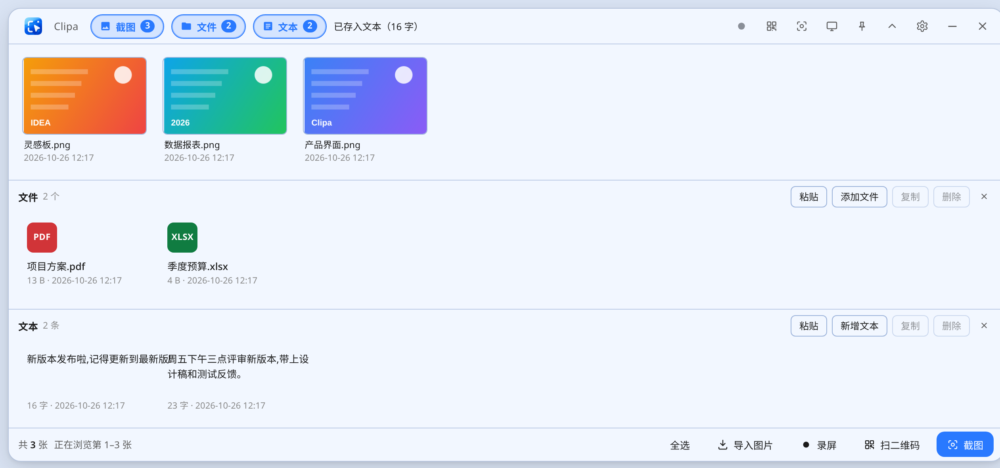
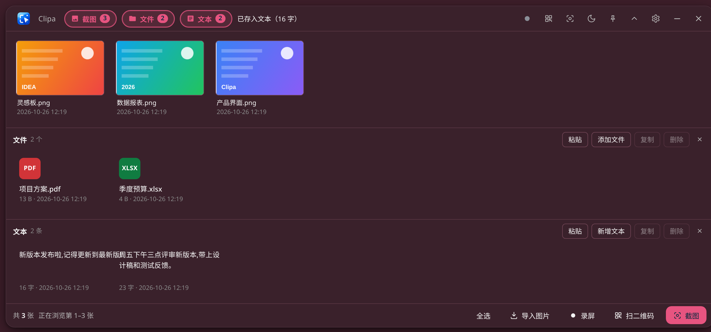
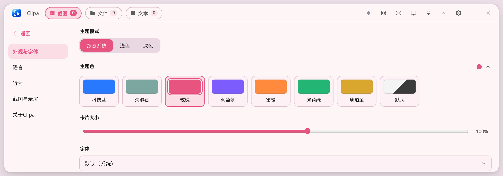
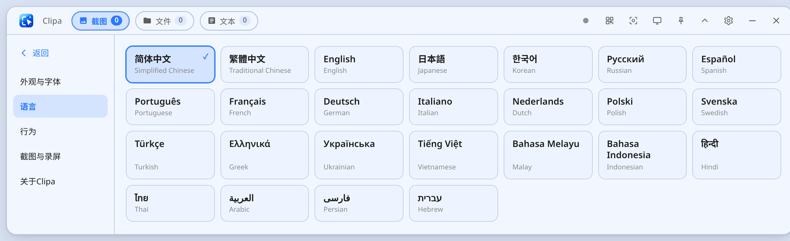
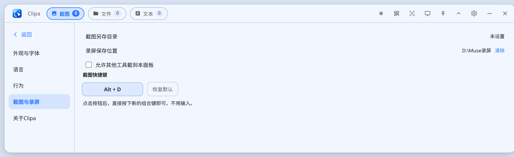

<p align="center">
  
</p>

<h1 align="center">Clipa</h1>

<p align="center">Windows 桌面剪贴站：截图、录屏、文件与文本的临时收纳面板，常驻屏幕顶部，鼠标碰一下刘海就展开。</p>

<p align="center">A Windows clipboard dock for screenshots, screen recordings, files and text snippets — parked at the top edge of your screen, always one hover away.</p>

## 功能

- **截图**：全屏 / 区域 / 窗口识别（微信式），选区内直接标注（画笔、箭头、矩形、马赛克、文字），截图悬停预览
- **录屏**：可选区域录制为 MP4（H.264，≤1920×1080，24fps，仅画面）
- **剪贴收纳**：截图 / 文件 / 文本三条泳道，多选、批量复制删除、拖入拖出、文件夹整理、卡片大小可调
- **全屏扫码**：点一下扫全屏二维码，多个码全部框出，点击直接打开链接；支持渐变、圆点等艺术二维码与反色码
- **二维码识别**：截图后可直接识别图中的码，链接自动用默认浏览器打开
- **删除联动**：删除卡片时可选择同时把另存到本地的原文件送进回收站
- **全局快捷键**：默认 Alt+D 截图，可在设置里按自己的组合键自定义（按下即录入）
- **主题与字体**：8 种主题色整窗联动染色、跟随系统 / 浅色 / 深色、任意系统字体
- **25 种语言**：简体中文、繁體中文、English、日本語、한국어、Русский、Español、Português、Français、Deutsch、Italiano、Nederlands、Polski、Svenska、Türkçe、Ελληνικά、Українська、Tiếng Việt、Bahasa Melayu、Bahasa Indonesia、हिन्दी、ไทย、العربية、فارسی、עברית
- **纯本地**：无账号、无服务器、无数据上传；设置保存在本机

## 界面截图

主界面（三条泳道：截图 / 文件 / 文本，Ctrl+V 自动分拣）：



深色模式 + 玫瑰主题色（整窗联动染色）：



外观与字体（主题模式、8 种主题色、卡片大小、系统字体）：



25 种语言，点卡片即换：



截图与录屏设置（另存目录、录屏位置、自定义快捷键按压录入）：




## 用户指南

每个功能的详细用法见 [USER_GUIDE.md](USER_GUIDE.md)。

## 下载

到 [Releases](../../releases) 下载：

- `Clipa-Full.exe`（完整版，约 79 MB）：自带 .NET 运行时，下载即用
- `Clipa-Lite.exe`（轻量版，约 28 MB）：需要系统装有 .NET 8 Desktop Runtime

未签名，首次运行如遇 SmartScreen 提示，点「更多信息 → 仍要运行」。

## 从源码构建

需要 .NET 8 SDK（Windows，或开启 `EnableWindowsTargeting` 的跨平台构建）。详见 [BUILDING.md](BUILDING.md)。

```powershell
# 把选好的页面放到宿主目录，改名为 app.html
copy app\Clipa.html host\app.html
cd host
dotnet publish -c Release -o publish-full
python patch_lang.py publish-full\MuseClipStation.exe   # 把版本资源语言改为中文
```

## 技术结构

- 界面层：单个自包含 HTML 文件（`app/`），无构建步骤，浏览器里也能直接打开预览（原生能力自动降级）
- 宿主层：.NET 8 + WebView2 的 WinForms 程序（`host/Program.cs`），负责截图、录屏、全局快捷键、托盘、刘海窗口形态
- 两层之间通过 WebView2 消息桥通信，协议见 [BUILDING.md](BUILDING.md)

## 许可

[MIT](LICENSE) © 青言悦语工作室
